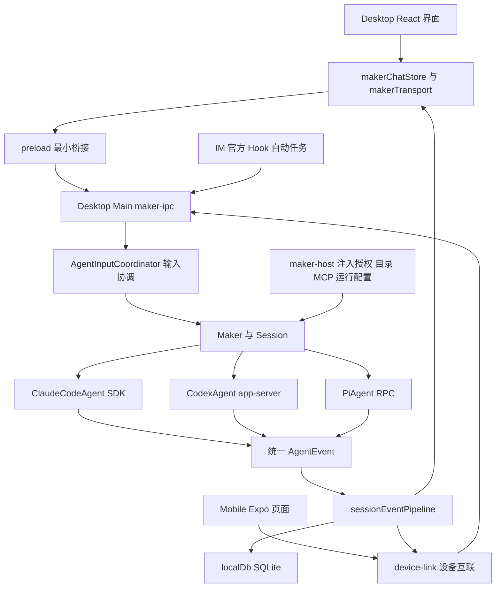

# Cindy 项目上手与功能源码教程

本文帮助客户端仓的新维护者先运行界面、再跟踪一次真实任务，最后按功能修改正确的模块。本文是学习导航；开发规则以各模块 AGENTS 和链接的专题正本为准。

源码基线为 `c1173f96e9`，核对日期为 2026-10-29。路径和符号比行号更适合长期定位，下面均给出文件入口和搜索关键词。

## 1 先理解产品和几个关键概念

Cindy 把已有 Agent、模型、工具和设备连接起来。桌面端承担本机任务执行与宿主能力，手机端通过设备互联查看、发送、审批和控制电脑上的任务。本仓包含客户端及共享包；账号、目录等服务端实现属于独立仓库。

| 概念 | 在本项目里的含义 | 对应源码 |
| --- | --- | --- |
| 引擎 Harness | 执行推理与工具循环的运行时，目前为 Claude Code、Codex、Pi | [AgentKind](../../packages/maker-core/src/types/common.ts) |
| 模型 Model | 引擎使用的具体模型型号；不是引擎本身 | [模型描述](../../packages/maker-core/src/types/capabilities.ts) |
| 供应商 Provider | 模型的接入来源，包含端点、授权、可用型号与路由 | [model-providers](../../packages/model-providers/src/index.ts) |
| 任务 Session | 面向用户的工作单元，有工作目录、历史、执行状态与底层运行时身份 | [Maker](../../packages/maker-core/src/maker.ts)、[Session](../../packages/maker-core/src/session.ts) |
| 消息 Message | 一条用户或助手往来；任务内的交流过程称为对话 | [命名规则](../product-rules/task-and-conversation-naming.md) |
| 能力 Capabilities | 声明当前引擎能否切模、回退、压缩、接图片、切权限等，UI 据此呈现 | [capabilities.ts](../../packages/maker-core/src/types/capabilities.ts) |
| 伙伴 Bot | 带身份、设置、记忆及生命周期的产品角色，底层仍由引擎执行 | [伙伴运行规则](../product-rules/cindy-bots-runtime.md) |
| Skill 与 MCP | Skill 提供可复用的方法；MCP 连接工具服务；都不自动成为新引擎 | [MCP 注入接口](../../packages/maker-core/src/interfaces/mcp-provider.ts) |

`cc-agent`、`useCCAgentChat` 等历史名字仍在使用，不能仅按名字判断它们只服务 Claude。数据库里也能看到历史 `cc` 标记；运行时的 Claude 引擎 ID 是 `claude-code`，不要全局替换这些字符串。

## 2 用一张图理解系统边界



这张图概括主要任务链路；各渠道的接线和行为差异仍以实际调用方为准。最重要的边界是：界面负责表达与呈现，Main 负责宿主接线，maker-core 负责引擎抽象与任务编排，vendor 运行时负责自身的 Agent Loop。

## 3 目录和包的阅读优先级

| 阅读顺序 | 位置 | 负责什么 |
| --- | --- | --- |
| 1 | [根 package.json](../../package.json)、[workspace](../../pnpm-workspace.yaml) | 运行命令、版本要求、工作区组成 |
| 2 | [Desktop renderer](../../apps/desktop/src/renderer/) | React 页面、输入框、消息展示、状态订阅 |
| 3 | [Desktop preload](../../apps/desktop/src/preload/preload.ts) | 给界面暴露受控的 Electron API |
| 4 | [maker-ipc](../../apps/desktop/src/main/maker-ipc/) | 创建、发送、排队、权限、事件与各业务入口接线 |
| 5 | [maker-core](../../packages/maker-core/src/index.ts) | Maker、Session、BaseAgent、事件、能力和注入接口 |
| 6 | [maker-host](../../apps/desktop/src/main/maker-host/) | 将凭证、模型目录、MCP、远程连接及存储接入 Core |
| 7 | [maker-shared](../../packages/maker-shared/src/)、[model-providers](../../packages/model-providers/src/) | 两端共享展示与行为契约，以及模型目录与选路 |
| 8 | [Mobile](../../apps/mobile/)、[device-link](../../packages/device-link/src/) | Expo 页面、远控调用、事件订阅和连接恢复 |
| 按需 | [maker-cc-manager](../../packages/maker-cc-manager/)、[maker-pi-manager](../../packages/maker-pi-manager/)、[maker-remote-ssh](../../packages/maker-remote-ssh/) | SSH 主机上的运行时守护与连接 |
| 按需 | [maker-scheduler](../../packages/maker-scheduler/)、[orca-workflow](../../packages/orca-workflow/) | 自动任务调度、多 Agent 协作 |
| 按需 | [cindy-tools](../../packages/cindy-tools/)、[lizi-mcps](../../packages/lizi-mcps/)、[browser-control-runtime](../../packages/browser-control-runtime/) | Cindy 工具、MCP 集成与浏览器运行时 |
| 发布时 | [tools](../../tools/)、[二进制准备脚本](../../scripts/ensure-agent-binaries.mjs) | 随包运行时的版本 pin、下载与校验 |

`maker-core` 不依赖 Electron，宿主差异通过接口与回调注入；共享包不能反向依赖 Desktop Main 或 Renderer。新增代码归属先对照 [架构不变量](architecture-invariants.md)。

## 4 第一次运行

### 4.1 确认仓库身份

本次检查到的远程配置为：

| Git remote | 用途 | 地址 |
| --- | --- | --- |
| `origin` | 当前项目 | `https://github.com/imagine-practice/cindy.git` |
| `ref-origin` | 原项目上游 | `https://github.com/makecindy/cindy.git` |

本地 `main` 当时跟踪 `ref-origin/main`，并非 `origin/main`；本地也未发现 `origin/main` 跟踪引用。普通 `git pull` 的来源取决于 tracking，不能凭 `origin` 的名字推断。此次没有拉取远端，因此不判断两个远端当前领先或落后多少。

开始开发前在 PowerShell 中确认：

```powershell
git status --short
git branch --show-current
git remote -v
git rev-parse --abbrev-ref --symbolic-full-name '@{u}'
git worktree list
```

新功能使用非默认分支，经 PR 进入你们的 `origin`；复用宿主已有的任务分支或 worktree。提交必须带 DCO 签名 `git commit -s`。推送与创建 PR 的时机依用户或宿主授权，详见 [开发工作流](development-workflow.md)。

### 4.2 准备依赖

先读 [环境安装](environment-setup.md)。根清单要求 Node `>=22.12`、pnpm `>=10.7 <11`，`packageManager` 固定 pnpm `10.33.2`；还需要 Git LFS。

```powershell
node --version
pnpm --version
git lfs version
git lfs pull
pnpm install
```

安装会尝试准备 Claude、Codex、ripgrep、Pi 的运行时资产及 Electron。不要用 `--ignore-scripts` 绕过；每个 worktree 有独立依赖目录。此次本机 Node 为 `24.21.0`、pnpm 为 `10.33.2`，仓库尚无 `node_modules`，因此后续运行步骤是教程步骤，并非已启动成功的记录。

### 4.3 先看界面，再验证真实执行

在仓库根目录运行：

```powershell
pnpm restart:desktop:remote -- --region=global --mock
```

应看到 `DESKTOP_DEV_VERDICT=ready`。`--mock` 使用模拟任务与独立沙箱，适合认识任务列表、消息、工具卡和主题；它不能证明真实模型、审批或远控运行正常。需要真实行为时退出模拟实例，使用：

```powershell
pnpm restart:desktop:remote -- --region=global
```

默认开发沙箱与正式业务数据隔离；模型登录态存在规则中明确的复用例外，详见 [Desktop 开发](desktop-development.md)。中国大陆版显式选择 `--region=cn`。手机 UI 可用 `pnpm mobile:sim:start -- --mock`；Windows 的 Android AVD 与原生开发包准备见 [Mobile 开发](mobile-development.md)。

第一次真实执行建议使用专门的练习目录：先让 Agent 阅读一个小文本并解释，再在合适权限档下创建一个小文件，最后练习停止与继续。这样可以同时观察输出、工具卡、权限和实际文件结果。

## 5 跟踪一次发送和一次返回

### 5.1 从输入框到引擎

按下面顺序打开文件，使用关键词定位，不必通读大文件：

| 步骤 | 文件与关键词 | 需要理解的问题 |
| --- | --- | --- |
| 1 | [ChatInput.tsx](../../apps/desktop/src/renderer/components/new-chat/ChatInput.tsx) | 输入、附件和选择的模型从哪里提交？ |
| 2 | [useCCAgentChat.ts](../../apps/desktop/src/renderer/hooks/useCCAgentChat.ts)，`sendMessage` | 页面动作如何交给任务状态管理？ |
| 3 | [makerChatStore.ts](../../apps/desktop/src/renderer/lib/makerChatStore.ts)，`sendMessage` | 本地输入状态、历史和运行状态如何协调？ |
| 4 | [makerTransport.ts](../../apps/desktop/src/renderer/lib/makerTransport.ts)，`makerApiFor` | 目标在本机还是另一台设备？ |
| 5 | [preload.ts](../../apps/desktop/src/preload/preload.ts)，`maker`、`maker:event` | 页面能调用哪些宿主 API？ |
| 6 | [register.ts](../../apps/desktop/src/main/maker-ipc/register.ts)，`sendToSessionInternal` | 如何恢复运行时、准备工作目录并接入输入协调？ |
| 7 | [agent-input-coordinator.ts](../../apps/desktop/src/main/maker-ipc/agent-input-coordinator.ts) | 繁忙时是排队、插话还是拒绝？输入何时算被接受？ |
| 8 | [maker.ts](../../packages/maker-core/src/maker.ts)，`createSession` | 如何按 `agentKind` 找到 Agent，并装配 Session？ |
| 9 | [session.ts](../../packages/maker-core/src/session.ts)，`send`、`handle.send` | 如何预约轮次、处理取消并跨过 provider 派发边界？ |
| 10 | [base-agent.ts](../../packages/maker-core/src/agents/base-agent.ts)，`AgentSessionHandle` | 具体引擎需要实现什么契约？ |

创建任务与发送消息不是同一个动作：已有记录可以在发送时惰性恢复运行时。Core Session ID、原生引擎 Session ID 和远程设备 ID 也不是同一个身份，定位恢复问题时分别核对。

### 5.2 从引擎事件到屏幕和历史

三套引擎各自的 [Claude translator](../../packages/maker-core/src/agents/claude-code/translator.ts)、[Codex translator](../../packages/maker-core/src/agents/codex/translator.ts)、[Pi translator](../../packages/maker-core/src/agents/pi/translator.ts) 将原生消息投影为统一 [AgentEvent](../../packages/maker-core/src/types/events.ts)。

先认识 `text`、`thinking`、`tool_use`、`tool_result`、`interaction_request`、`done` 和 `error`。文本增量、工具开始、工具结果与轮次结束各有独立语义，不能把所有 JSON 拼成助手文本。

Main 的 [sessionEventPipeline.ts](../../apps/desktop/src/main/maker-ipc/sessionEventPipeline.ts) 连接事件准备、流式持久化、分发及终态处理。顺着它可以找到各步骤：

- 任务元数据的 Core 存储适配在 [session-storage.ts](../../apps/desktop/src/main/maker-host/session-storage.ts)。
- 业务表结构与数据库入口在 [schema.ts](../../apps/desktop/src/main/localDb/schema.ts) 和 [localDb/index.ts](../../apps/desktop/src/main/localDb/index.ts)。
- 界面通过事件桥更新 `makerChatStore`，再由 `useCCAgentChat` 订阅。
- 手机通过设备互联消费执行端状态；不是在手机里再运行一套本地引擎。

特别留意 `error` 的终态判据：可重试错误不等于轮次已结束。排查“界面一直转圈”时，检查终态事件、持久化和状态广播，不能只补一个前端 `loading=false`。

### 5.3 从审批请求到继续执行

审批链可以按“引擎请求 → `interaction_request` → 宿主与界面呈现 → 用户决定 → resolver 回传 → 引擎继续”阅读。入口包括 [权限类型](../../packages/maker-core/src/types/permissions.ts)、[事件与交互类型](../../packages/maker-core/src/types/events.ts)、[跨端权限判据](../../packages/maker-shared/src/permissionMode.ts) 和 [权限变更](../../apps/desktop/src/main/maker-ipc/sessionPermissionChange.ts)。

用户已回答、宿主收到决定、引擎真正恢复是不同阶段。涉及手机和 IM 时先读 [IM 权限确认规则](../product-rules/im-permission-confirmation.md)，不要在渠道里独立发明最终决定。

## 6 按功能学习源码

| 想学习或修改的功能 | 先看代码 | 先读规则 |
| --- | --- | --- |
| 新建任务、默认引擎和模型 | [newMakerDefaultTuple](../../apps/desktop/src/shared/newMakerDefaultTuple.ts)、[手机新建页](../../apps/mobile/app/sessions/new.tsx) | [仓库地图](repo-map.md)、[模型维护](model-catalog-maintenance.md) |
| 发送、排队、插话、停止与继续 | [输入协调器](../../apps/desktop/src/main/maker-ipc/agent-input-coordinator.ts)、[Session](../../packages/maker-core/src/session.ts) | [任务回归场景](session-regressions.md) |
| 引擎接入 | [BaseAgent](../../packages/maker-core/src/agents/base-agent.ts)、[宿主注册](../../apps/desktop/src/main/maker-host/index.ts) | [Agent 行为](maker-core-and-agent-behavior.md)、[Pi harness](pi-harness.md) |
| 模型与自定义供应商 | [providerInterfaceRoutes](../../packages/model-providers/src/providerInterfaceRoutes.ts)、[离线目录](../../packages/model-providers/catalog/) | [模型维护](model-catalog-maintenance.md)、[配置覆盖](configuration-and-overrides.md) |
| 任务持久化和恢复 | [session-storage](../../apps/desktop/src/main/maker-host/session-storage.ts)、[sessionActiveTurn](../../apps/desktop/src/main/localDb/sessionActiveTurn.ts) | [数据库迁移](database-and-migrations.md) |
| 手机任务发送和远控 | [useMobileMakerTransport](../../apps/mobile/src/device-link/useMobileMakerTransport.ts)、[Desktop device-link](../../apps/desktop/src/main/device-link/index.ts)、[协议](../../packages/device-link/src/protocol.ts) | [远程与手机适配](remote-and-mobile-adaptation.md)、[协议兼容](protocol-compatibility.md) |
| SSH 上运行引擎 | [maker-remote-ssh](../../packages/maker-remote-ssh/)、[cc-manager](../../packages/maker-cc-manager/)、[pi-manager](../../packages/maker-pi-manager/) | [远程与手机适配](remote-and-mobile-adaptation.md) |
| 伙伴的身份与运行时 | [botProfileRuntime](../../apps/desktop/src/main/maker-ipc/botProfileRuntime.ts)、[bot-autonomy](../../apps/desktop/src/main/bot-autonomy/) | [伙伴运行](../product-rules/cindy-bots-runtime.md)、[伙伴权限](../product-rules/teammate-authority.md) |
| 伙伴群聊与云端伙伴 | [botGroupChatService](../../apps/desktop/src/main/maker-ipc/botGroupChatService.ts)、[companion-cloud](../../apps/desktop/src/main/companion-cloud/) | [伙伴群聊](../product-rules/bot-group-chat.md)、[云端伙伴](../product-rules/cloud-companions.md) |
| 自动任务 | [maker-scheduler](../../packages/maker-scheduler/)、[scheduler-host](../../apps/desktop/src/main/scheduler-host/index.ts)、[共享表单](../../packages/maker-shared/src/scheduleForm.ts) | [Agent 与用户同权](../product-rules/agent-user-parity.md) |
| 多 Agent 协作 | [orca-workflow](../../packages/orca-workflow/)、[orcaTeam](../../packages/maker-shared/src/orcaTeam.ts) | [Orca 架构](orca-team-architecture.md) |
| IM 与官方 Hook | [im/index.ts](../../apps/desktop/src/main/im/index.ts)、[hook-control](../../apps/desktop/src/main/hook-control/index.ts) | [IM 轮次流程](im-turn-flow.md)、[消息来源](../product-rules/message-source.md) |
| 插件与工具发现 | [cindy-brain](../../apps/desktop/src/main/cindy-brain/index.ts)、[cindy-tools](../../packages/cindy-tools/) | [插件安全与编写](plugin-security-and-authoring.md)、[渐进发现](../ghost-progressive-discovery.md) |
| 浏览器、文件与终端 | [browser-control-runtime](../../packages/browser-control-runtime/)、[file-browser-core](../../packages/file-browser-core/)、[terminal](../../apps/desktop/src/main/terminal/) | [Electron 边界](electron-security-and-process-boundaries.md)、[本地存储](credentials-and-local-storage.md) |
| 界面、主题与多语言 | [renderer](../../apps/desktop/src/renderer/)、[design-tokens](../../packages/design-tokens/)、[术语表](../../i18n/GLOSSARY.md) | [DESIGN](../design-rules/DESIGN.md)、[设计治理](../design-rules/design-governance.md) |

模型目录有 Server 正本、客户端离线副本和用户覆盖等层级。改目录之前先理解覆盖顺序；目录中出现一个型号，不代表对应引擎和线上服务已经能够执行它。

## 7 四个循序渐进的练习

### 练习一 看懂一条消息

用 mock 启动 Desktop，选一条带工具卡的任务。定位 `useCCAgentChat` 的订阅、`makerChatStore` 的快照和 `AgentEvent` 的工具字段。完成标准：能说明“界面在哪里显示，实时状态从哪里来，重启后的历史从哪里来”。

### 练习二 看懂繁忙时的第二次输入

先读 [agent-input-coordinator.test.ts](../../apps/desktop/src/main/maker-ipc/__tests__/agent-input-coordinator.test.ts)，再跟进生产协调器。画出空闲、运行中、排队、停止四种状态下第二条输入的去向。完成标准：能解释排队和 `steer` 的区别，以及为什么不应在每个渠道复制队列。

### 练习三 看懂一个模型选择

从 `newMakerDefaultTuple` 跟到 `model-providers`，记录引擎、provider ID、模型 ID 和接口选择分别在哪里确定。完成标准：能说明“增加供应商”和“增加引擎”各需要改哪一层。

### 练习四 看懂一张工具卡

用 mock 启动 Desktop，挑一个带 `tool_use` / `tool_result` 的任务，从 [Claude translator](../../packages/maker-core/src/agents/claude-code/translator.ts) 跟到 [sessionEventPipeline](../../apps/desktop/src/main/maker-ipc/sessionEventPipeline.ts)，再看 `makerChatStore` 如何把它投影成卡片。完成标准：能说明工具开始、参数流、结果与错误分别由哪种事件表达，以及为什么不能把它们拼成助手文本。

学习计划可安排为：第一天完成环境、mock 和练习一；第二天完成发送、事件、权限链及练习二；第三天学习模型与远程链，再选择自己要负责的功能继续深入。时间仅是阅读安排，不是工程工期承诺。

## 8 验证方法和常见误区

装好依赖后，优先运行已有的定向测试：

```powershell
pnpm --filter desktop exec vitest run src/main/maker-ipc/__tests__/agent-input-coordinator.test.ts
pnpm --filter desktop exec vitest run src/main/maker-ipc/__tests__/makerSendTransaction.test.ts
pnpm --filter desktop exec vitest run src/main/maker-ipc/__tests__/sessionEventPipeline.test.ts
pnpm test:unit:related
pnpm --filter desktop run typecheck
pnpm --filter @cindy/maker-core run build
pnpm check:dev-docs
```

按实际改动选其中相关项，不需要每次全跑。`maker-core` 当前的类型检查入口是 `build`，内容为 `tsc --noEmit`，并没有名为 `typecheck` 的脚本。UI 改动还需按模块规则运行 UI 检查，主题颜色同时实现 Light 和 Dark；新增测试遵守 [工程约定](engineering-conventions.md) 的价值门槛。

经常导致返工的做法有：只改模型下拉框却遗漏路由与持久化；把 `useMakerSession` 诊断 hook 当成正式聊天入口；只处理界面 loading 而漏掉 Main 终态；手机与桌面各自写一套权限或默认模型逻辑；从数据库表的 TypeScript enum 直接推断需要修改历史 migration。

排查时使用 `rg -n '符号名' 路径` 追调用方，结合既有测试验证可观察结果。system prompt、协议、权限、用户数据与插件基座分别有专项门禁，不能把它们当普通字符串或类型改动处理。
